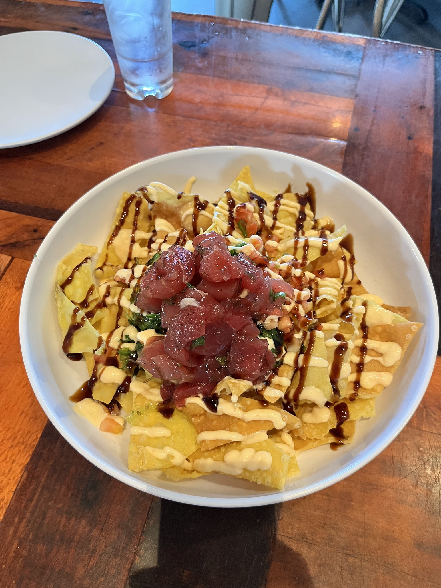

People always ask me since you have travelled to so many places, have you been to hawaii yet? 

Finally, this time, I can confidently say I have. Not only did I have, but I did some crazy things I will forever remembering such as cliff jumping 40 feet from the southmost point of the US.

I was supposed to be in Cananda for the whole month visiting all the famous national parks there but plans changed. I always imagine my Hawaii trip would be a meticulously planned, long prepared one, but instead, it's one of the very few spontenous trip I made, just two weeks ago since I had the idea. It turns out spontenous trips are not that bad. It has its own charm.

## Hawaii Poke

I rarely talked about food because i'm hardly a foodie and on a trip i'd like minimum viable food. However, the poke here in hawaii definitely deserves a mention as it is so plain but so good. We had a tuna nachos which was probably ther best nachos i ve had in my life. It looks very simple, some sauce, nachos, and tunas. But the flavor blends in so well and i was so impressed by the freshness of the ingredients. 

## Hilo
We decided to spend 3 days staying in Hilo, which is on the other side of the island from the airport. The main reason was the budget friendly price and its proximity to the volcanos national park. However, the weather really troubles me here. I remmebr first night staying here, i vaguely remember waves after waves of heavy rain hitting the root, creating those unplesant sounds. Rains were supposed to help me sleep, but this time, it was way too much. 

However, staying in this town really gave me a chance to see the unfiltered life of local residents. Hawaii is not as glamours as it sounds. People here are sometimes struggling with the high price of living while the poor infrastructure persists. I was told locals work multiple times to afford a living is a very common thing here.

The good thing about rainning is, we saw a lot of rainbows here, just as the hawaii car plate pattern suggests. It is indeed a rainbow state.

## Hawaiʻi Volcanoes National Park

### Crater hike
This is truly something I've never seen before. I went to Iceland hoping to do the volcano hike but unfortunetly the volcano erupted weeks before our trip. But this time, it's a true volcano, or i should say, true volcanos.

Once I came here, I kept saying: God is bipolar. The weather here is extremely unpredictable as it could be sunny now but pouring in the next few minutes. Same thing in the national park, we started hiking in drizzeling and cloudy weather but when we reached the center of the volcano crater, the sky started becoming sunny. 

Standing in the center of the crater, it feels very surreal to me. As thousands of thousands of years ago, this place is the epiccenter for volcanic eruptions. To some extent, I am a witness of this long history of the island and of the earth now, which is quite poetic haha. 

### Devastation trail

It's called devastation trail because the trail did not exist before as the ground was created by a volcano eruption decades ago. It is truly a land of devastation, with absolutely nothing on the ground. I normally prefer the colorfulness of the nature with snow white, tree green, sky blue, river turquoise. But right now, this peacefulness or deadness of pure grey on the ground, also has its own charm. It's hard to imagine being the first person walking on this land of devastation, as you would feel like walking on mars and being the only person alive on this planet. That solitude, is hard to beat. 

### Chains of Crater Road
It turns out there are way more volcano and crater than I thought. Driving on the road called Chains of crater, we saw lava just casually spanning along the road, or i should say, this road casuallly strentching on top of these lava remains. It is really unearthly but breathtaking in its own way. We saw a dozens of volcano crater and each one of them has such different characteristics depending on the depth, rocks, width, and color. It is a family of craters here.

### Mauna Kea
It's the highest point on the island and one of the biggest volcano in the world. In fact, the entire island is formed by Mauna Kea and Mauna Loa, which means everything we see on the Big Island is part of the volcano. It's just crazy for me to think about the vastness of the volcano. It's like the ocean, or the mother of earth. They are so generous in a way that they provide everything for us but never ask anything back. It's the most beautiful thing about nature i can think about. We are always asking and nature is always giving. 

Driving up to the summit of Mauna Kea was probably the most amazing drive i've ever done in my life. It simply leaves me speechless, speechless and speechless. For the first time, I was crying over a sunset, not once but twice.

The drive was rated as a little bit challenging and the park rangers checked evreyone's car before going up to make sure it's four wheel drive with more than half of the fuel. I did some diffcult drive before in Iceland and Alaska but nothing like this before. I was quite nervous starting driving up the mountain but it gets better because of the view. I was literaelly driving above all the clouds and feel like the cloest to the sky and heaven. Even in my imagination, I could not believe this road, this view, this mountain exist. Nature is the best imagination as we little human can get a fraction of.

Reaching the summit, there are many telescopes facilities from around the world to do astronomy research here as it is the best place in the world without light pollutions and high altitude to do such research. However, I was more interested in the nature, in the unobstructed view of the sunset above clouds. 

It was truly an amazing experience looking at the sunset graduatlly set below the cloud and render the entire sky into an unspeakable heavely color. Color palette of this nature is truly truly amazing. I was just froze there, quietly enjoying this view while crying.

At 13803 feet high, i was freezing while the sun sets but the view warms my heart and my mind. 

Driving down the road was even more challenging as the sky becomes dark and I could barely see the gravel roads. The brake turns out to be really hot and I can smeel the burning of my brake. Thus, I had to make frequent stops on the way to cool down the brake while letting other cars pass. But even that, I can't help but looking at the view of the sky after sunset. The color, is simply amazing.

These kind of view make me feel how powerless i am with my poor language to describe a perfect experience like this. I ended up coming back again the second day to see the sunset again, equally amazing and left me speechless for a long time. 

## Cliff jumping at Southmost point in the US
Another life changing experience for me. I've always wanted to do real cliff jumping but never had a chacne. The closest thing I've done was in Cinque Terre in Italy which was about 20 feet high.

When I see people jumping from this cliff at the southmost point in the big island, I just could not resist. The night before I was reading all the horriable incidents happened here where helicopter came to rescue people and today i have all the adrenaline to try it out.

I actually hesitated for a while watching other people jumping down as it was truly quite scary when I stand on the edge of this 40 feet tall cliff. However, when I'm ready, I just went straight and jumped into the air without knowing what or where to go in the air. 

At that moment, I have an epiphny. Life isn't about fguring out everything, it is about experiencing everything. All I need to do is jump rather than figuring out what to do in the air and how to not get hurt in the water. 

I did it 3 times. Two times for the camera and once for myself. I truly enjoy the adrenaline rush while jumping but also the closeness to nature i can get from this jump that nothing else could offer. My body hurt a lot after the jump and i can see all the bruises on my waist, back and thigh. However, it was truly worth it. 

Driving on the way back, i felt like reborned. My mind was way clearer and i felt so alive like never before. Nothing matters in life anymore. Troubles, dramas, traumas, all gone.

I really enjoyed this experience and i hope one day i could do it again somewhere. This is waht I live for and I only live once.

## Cultural heritage on the island
"You buy the land-you get the people land & people ae one - useparaable." That's probably the most powerful statement I've seen. Pacific islanders are resisting to the creation of more resorts and privatization of lands which drives other people out of the 

---

> ***I didn't finish writing this blog and I found the draft a year later. I still want to post this to remember and preserve the authenticity. Also, the thumbnail is too pretty to not be published.***

